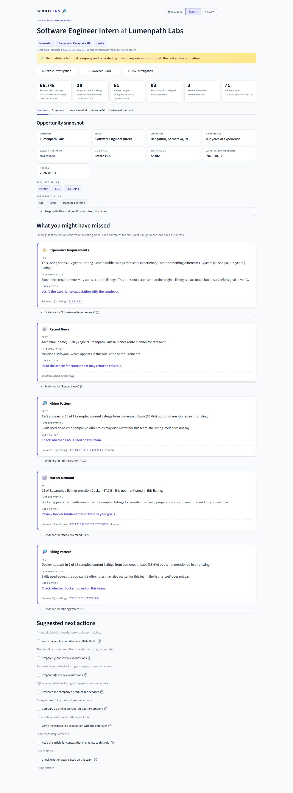
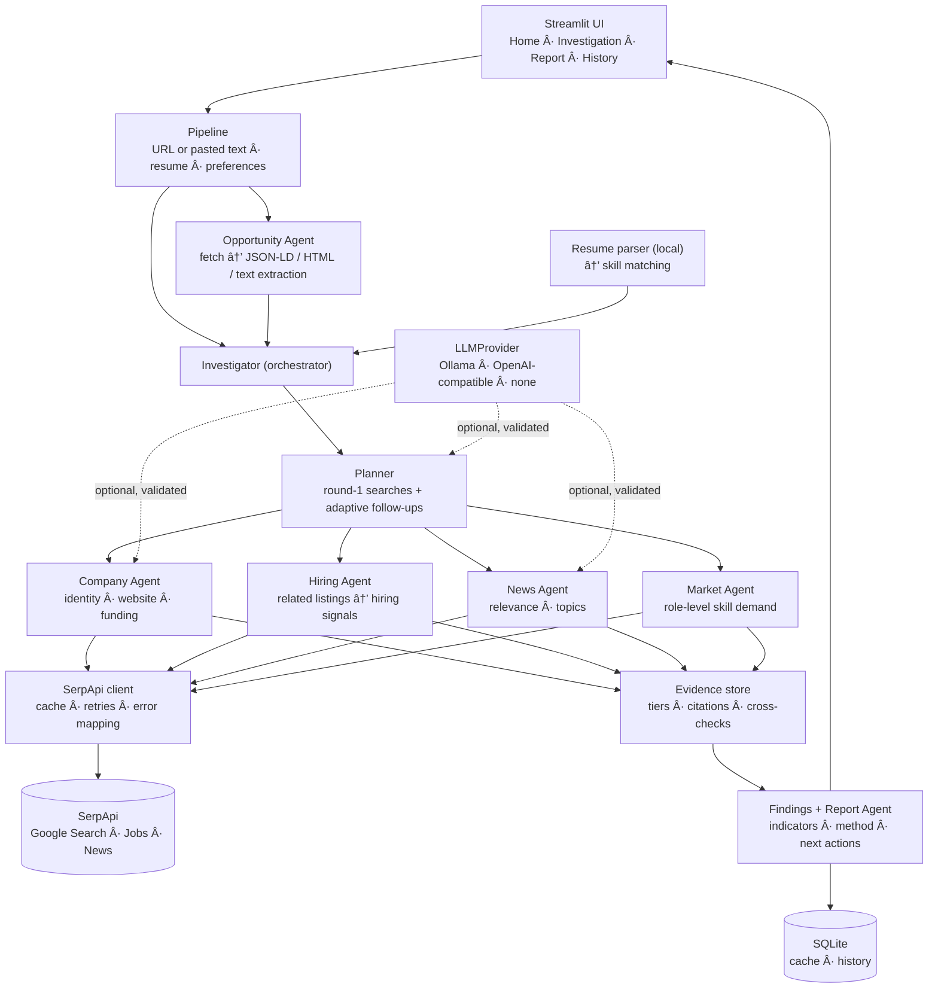
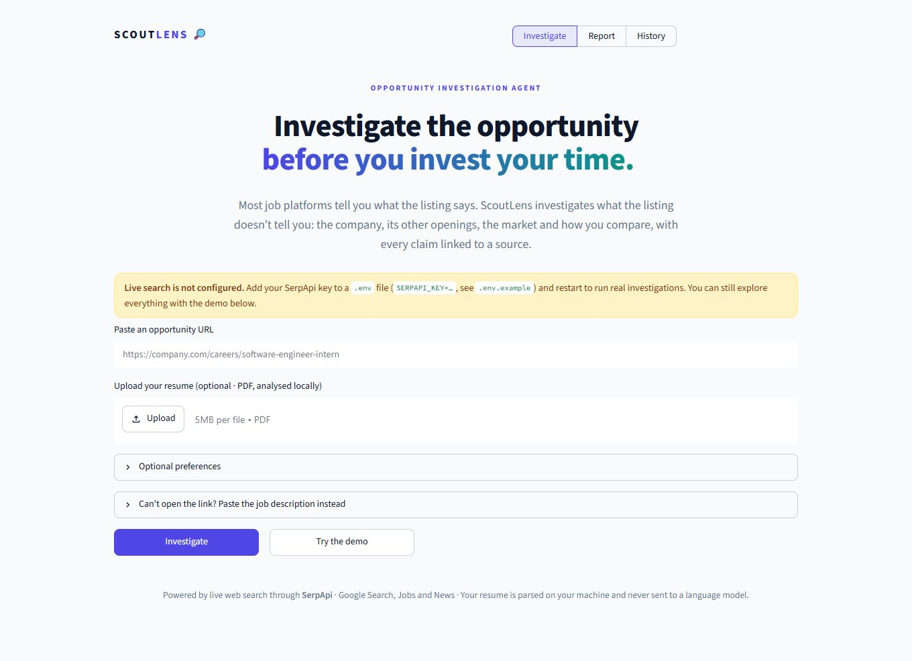
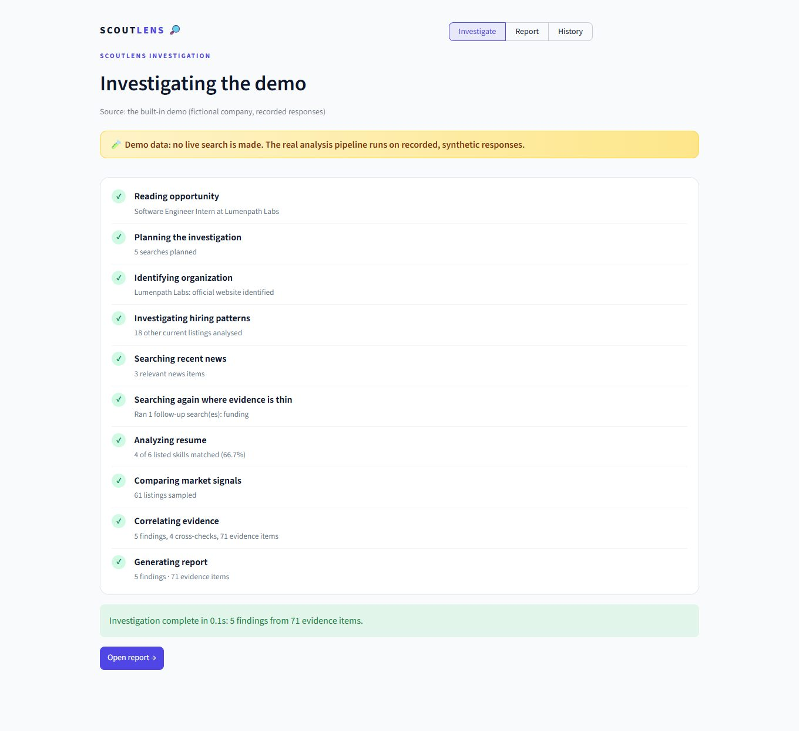
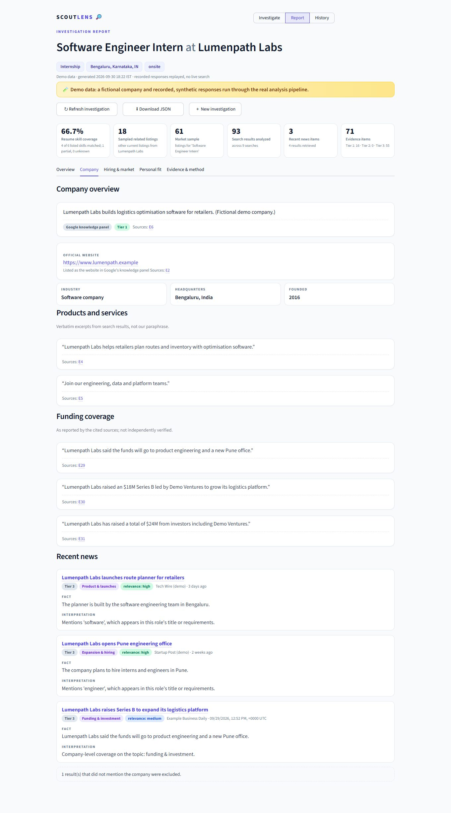
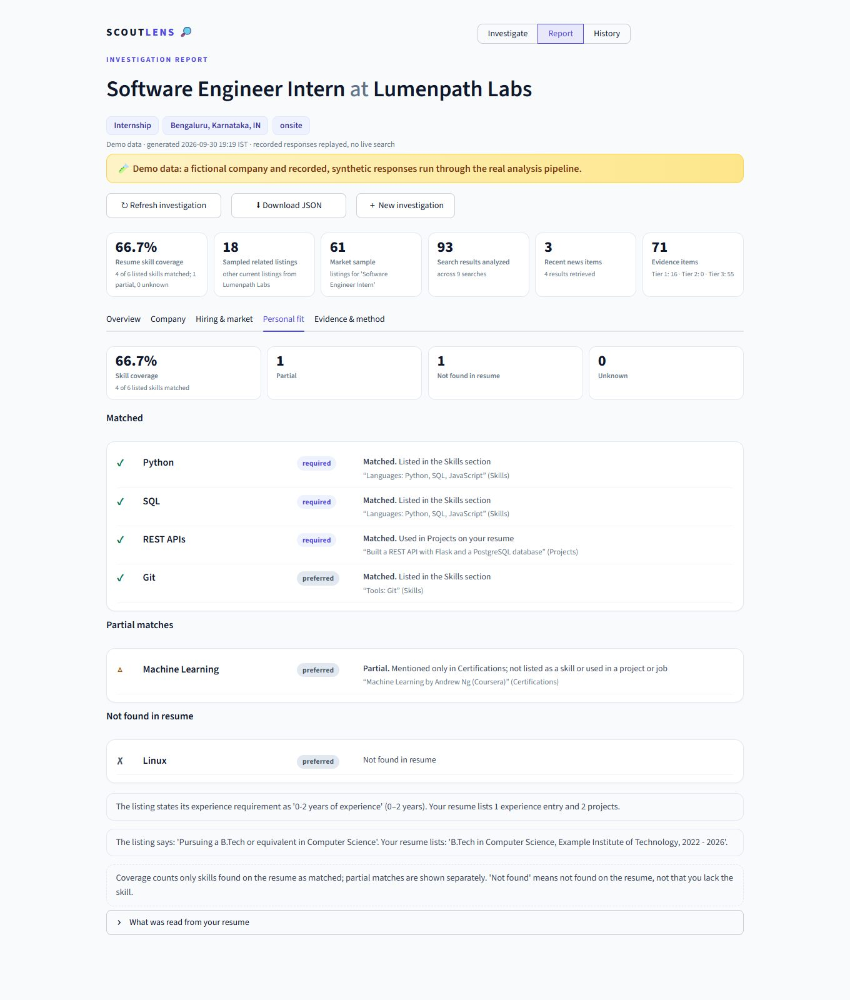

# ScoutLens 🔎

**Investigate the opportunity before you invest your time.**

ScoutLens is an AI-powered opportunity-investigation agent. Give it a job or internship link (and optionally your resume) and it uses **live web search through [SerpApi](https://serpapi.com)** to investigate the listing, the employer, the employer's other current openings, recent news and the wider job market, then hands back an **evidence-backed report where every claim links to a real source**.

> Built for the **SerpApi India Hackathon 2026**.
> Most job platforms tell you what the listing says. ScoutLens investigates what the listing *doesn't* tell you.



<sub>Screenshots use the built-in **demo** (a fictional company with recorded, synthetic responses), so they never show real-company claims. See [Demo mode](#demo-mode).</sub>

---

## Contents

[Problem](#problem) · [Solution](#solution) · [Features](#features) · [What you might have missed](#what-you-might-have-missed) · [Architecture](#architecture) · [SerpApi integration](#serpapi-integration) · [AI architecture](#ai-architecture) · [Evidence and honesty rules](#evidence-and-honesty-rules) · [Tech stack](#tech-stack) · [Installation](#installation) · [Environment variables](#environment-variables) · [Running](#running) · [Demo mode](#demo-mode) · [Testing](#testing) · [Privacy and security](#privacy-and-security) · [Project structure](#project-structure) · [Limitations](#limitations) · [Future improvements](#future-improvements) · [AI disclosure](#ai-disclosure)

---

## Problem

A job listing is a marketing document. It rarely tells you:

- what else the company is hiring for, and which skills recur across those roles,
- whether the experience requirement matches the company's other comparable listings,
- what recent news says about the company or the team,
- which skills are actually in demand in the market for this role, and how your profile compares.

Answering those questions by hand means a dozen tabs, and it's easy to over-trust whatever the first search result says.

## Solution

Paste a URL. ScoutLens **plans an investigation**, runs real Google Search / Google Jobs / Google News queries through SerpApi, **searches again where evidence is thin**, cross-checks important claims, compares everything with your resume, and produces a structured report that separates **FACT** (what a source said) from **INTERPRETATION** (what it might mean) from **USER ACTION** (a neutral next step).

It informs your decision. It never tells you whether to apply.

## Features

| | |
|---|---|
| **Opportunity extraction** | JSON-LD `JobPosting` → HTML metadata → text heuristics. Robots.txt-aware, SSRF-safe fetching. Manual paste fallback when a page can't be read. |
| **Company intelligence** | Official website (with the basis for that conclusion), knowledge-panel facts, verbatim product/funding excerpts, recent news, each with a source tier. |
| **Hiring signals** | Skill frequencies across the employer's *other current listings*, computed only from collected data, with the sample size always shown ("Among the 18 listings analyzed…"). |
| **Opportunity vs. pattern** | Neutral comparison of experience, skills, location, work mode and salary against the employer's comparable listings. |
| **Market skill signals** | "23 of 61 sampled listings mention Docker (37.7%)", from a role-level sample so the query can't inflate the number. |
| **Personal fit** | Matched / partial / **not found in resume** / unknown, with the resume line that justifies each status. Resume parsed **locally**. |
| **What you might have missed** | Up to five findings not obvious from the listing, each with evidence. |
| **Evidence engine** | Every source classified Tier 1/2/3, cross-checked, and linked. The LLM can cite evidence but can never invent it. |
| **Transparent method** | Timestamp, searches performed (live vs cached), APIs used, listings and news analysed, LLM usage. |
| **Caching & refresh** | SQLite cache saves SerpApi credits; **Refresh** bypasses it. |
| **History** | Reopen or delete past investigations (stored locally). |
| **Graceful failure** | Partial reports instead of tracebacks; a specific, safe message for every error class. |

## What you might have missed

The signature feature. Example (from the demo data):

> 🔎 **Hiring Pattern**
> **FACT** Docker appears in 7 of 18 sampled current listings from Lumenpath Labs (38.9%) but is not mentioned in this listing.
> **INTERPRETATION** Skills used across the company's other roles may also matter for this team; the listing itself does not say.
> **USER ACTION** Check whether Docker is used on this team.
> *Sources: 7 job listings · E7 E8 E10 E11 E17 E21 E24*

Other finding types: experience-requirement variation across comparable listings, recent relevant news, market demand for a skill missing from your resume, work-arrangement and salary differences, listing age, and application-deadline timing. A finding **cannot exist without evidence** (enforced by the data model), findings are varied (no five near-identical cards), and all wording is neutral by construction.

## Architecture



Investigation stages (each is a real operation, reported live in the UI in true execution order):

`read → plan → identify → hiring → news → follow-up → resume → market → correlate → report`

**Why not `URL → scrape → LLM → summary`?** Because that has no evidence trail. Here the intelligence comes from *live search + evidence correlation + agent planning + user context*, and the LLM is an optional, validated enhancer, not the source of truth.

## SerpApi integration

SerpApi is the product's data source, not a badge. Three engines, each used because it contributes evidence nothing else here could:

| Engine | Used for | Evidence produced |
|---|---|---|
| **Google Search** (`google`) | Company identity: knowledge panel, official website, industry, product excerpts, funding coverage, follow-up "official website" search | Company facts, official-site sources, funding excerpts |
| **Google Jobs** (`google_jobs`) | (a) the employer's other current listings → **hiring signals**; (b) a **role-level market sample** (up to 3 pages) → **market skill signals**; (c) cross-checking that *this* listing exists in an independent index | Job listings (each a citable source) |
| **Google News** (`google_news`) | Recent coverage of the employer, ranked by relevance and recency | News items with publisher and date |

I deliberately did **not** add Scholar or Trends: they add no evidence for a job investigation.

How SerpApi is used well:

- **Adaptive planning**: the funding search is skipped for established companies; an "official website" search runs only if the first search didn't establish one; job/news fallbacks run only when the first round found nothing. A budget caps follow-ups.
- **Unbiased market sampling**: skill percentages come from a search on the *role title only*. Searching "Docker + role" would return listings that mention Docker by construction and inflate the percentage.
- **Credit-aware**: read-through SQLite cache (TTL configurable), pagination via `next_page_token`, and the report shows how many searches were live vs cached. Typical investigation: **9–12 searches** (identity 1, funding 1, company jobs 2 pages, similar roles 1, news 1, market 3 pages, up to 3 follow-ups).
- **Robust parsing**: response parsers follow SerpApi's documented formats (including `iso_date` for news and `next_page_token` pagination) and drop unusable items instead of crashing.
- **Key safety**: `requests` puts `api_key` in the URL, and its exception text includes that URL, so every error path is redacted before it can be logged or shown.

The report's **Evidence & method** tab lists every search (API, query, purpose, live/cached, result count, timestamp).

## AI architecture

A small set of single-purpose agents; no framework, no unnecessary complexity.

| Component | Responsibility |
|---|---|
| **Opportunity Agent** | Fetch and extract a structured `OpportunityProfile` (unknown fields stay `None`; `field_sources` records provenance). |
| **Investigation Planner** | Decides which searches are worth a credit; issues follow-ups from what was actually found. Optional LLM may propose ≤ 2 extra queries (validated: must name the company; deduplicated; capped). |
| **Company / Hiring / News / Market Agents** | Run searches and analyse results into typed models (`CompanyProfile`, `HiringSignal`, `NewsSignal`, `MarketAnalysis`). |
| **Resume Agent** | Deterministic, local PDF → `ResumeProfile` with skill provenance, then skill matching. |
| **Evidence Store & cross-checks** | The only place `EvidenceItem`s are created; classifies sources; corroborates claims. |
| **Report Agent** | Findings (max 5), indicators, method, neutral next actions → `InvestigationReport`. |
| **LLMProvider** | `Ollama`, `OpenAI-compatible` or `none`. Structured output is JSON → **Pydantic-validated** with a bounded repair loop; nothing arbitrary is ever accepted. |

**Deterministic core, LLM as validated enhancer.** The complete report works with `LLM_PROVIDER=none`. When a model is available it may: write a company overview (every sentence must cite `[E#]` evidence; uncited or invalid-citation sentences are **dropped**), refine news relevance (one validated batch call), and suggest extra queries. Non-neutral wording ("scam", "you must learn…") is rejected by a language guard, and the deterministic text is used instead. **Your resume is never sent to a model.**

## Evidence and honesty rules

- **NO SOURCE = NO FACT.** Evidence items can only be created from objects SerpApi actually returned (search hit, job, news item, knowledge panel) or the listing page that was fetched. A `Finding` with no evidence fails validation. LLM prose is checked sentence by sentence against the store.
- **Source tiers** are visible everywhere: **Tier 1** official company site/listing, government, university, primary research · **Tier 2** established news and industry publications, Google knowledge panel · **Tier 3** aggregators, forums, community-edited and unclassified sources. Unknown domains default to Tier 3.
- **Cross-checks** report `corroborated`, `single source`, `conflicting information` or `insufficient evidence`. They never say a claim is false.
- **Neutral language** (test-enforced): "Potential discrepancy", "Unverified information", "Evidence requiring further verification". Never "scam", "fake", "definitely apply".
- **"Not found in resume" ≠ "you don't know X."** Sparse resumes yield *unknown*, not *not found*.
- **No overall score.** Independent, measurable indicators instead: resume skill coverage (with the arithmetic), sampled listings, sources analysed, news items, evidence items by tier.
- **Insufficient evidence** is stated explicitly instead of filling gaps.

## Tech stack

- **Python 3.11**, **Streamlit** (custom design system, no default look)
- **Pydantic v2** for every structured output and settings (`pydantic-settings`)
- **SerpApi** REST API (`requests`)
- **Ollama** or any **OpenAI-compatible** endpoint (optional), behind a `LLMProvider` abstraction
- **SQLite** for cache and history
- `beautifulsoup4` + `lxml` (extraction), `pypdf` (resume, local)

> The brief listed PydanticAI. I used plain Pydantic plus a small `LLMProvider`: it is simpler, has fewer dependencies, and gives full control over validation and repair.

## Installation

Requirements: **Python 3.11+** and a [SerpApi key](https://serpapi.com/manage-api-key) (free tier works; not needed for the demo).

```bash
git clone <your-repo-url> scoutlens
cd scoutlens

# create and activate a virtual environment
python -m venv .venv
# Windows (PowerShell):   .\.venv\Scripts\Activate.ps1
# Windows (cmd):          .venv\Scripts\activate.bat
# macOS / Linux:          source .venv/bin/activate

pip install -r requirements.txt          # add requirements-dev.txt to run the tests
cp .env.example .env                     # Windows: copy .env.example .env
```

Edit `.env` and set `SERPAPI_KEY`. For LLM features with Ollama:

```bash
ollama pull llama3.1:8b      # ~4.7 GB; optional, or set LLM_PROVIDER=none
```

## Environment variables

Copy [`.env.example`](.env.example) to `.env` (git-ignored). Secrets are held as `SecretStr` and never rendered.

| Variable | Default | Purpose |
|---|---|---|
| `SERPAPI_KEY` | – | Required for live investigations (not for the demo) |
| `SERPAPI_GL` / `SERPAPI_HL` / `SERPAPI_LOCATION` | `in` / `en` / `India` | Localisation of results |
| `LLM_PROVIDER` | `ollama` | `ollama`, `openai` (any OpenAI-compatible API) or `none` |
| `OLLAMA_BASE_URL` / `OLLAMA_MODEL` | `http://localhost:11434` / `llama3.1:8b` | Local model |
| `OPENAI_BASE_URL` / `OPENAI_API_KEY` / `OPENAI_MODEL` | OpenAI defaults | OpenAI-compatible provider (Groq, Together, LM Studio, vLLM…) |
| `CACHE_TTL_HOURS` | `24` | SerpApi response cache lifetime (`0` disables) |
| `MAX_RESUME_MB` | `5` | Upload size limit |
| `DB_PATH` | `data/scoutlens.db` | SQLite file (use a local path if your project folder is cloud-synced) |
| `COMPANY_JOB_PAGES` / `MARKET_PAGES` | `2` / `3` | Result pages per job search (1 credit each) |
| `MAX_FOLLOW_UP_SEARCHES` | `3` | Budget for adaptive follow-up searches |
| `LLM_PLANNING` | `false` | Let the LLM propose up to 2 extra queries |
| `DISPLAY_TIMEZONE` | `Asia/Kolkata` | Timezone for the "search timestamp" |
| `LOG_LEVEL` | `INFO` | Logging level |

If the LLM is unreachable, the run continues with deterministic analysis and says so in the report.

## Running

```bash
streamlit run app.py
```

Open http://localhost:8501, paste an opportunity URL, optionally upload a resume PDF and set preferences, and click **Investigate**. No key yet? Click **Try the demo**.

## Demo mode

**Try the demo** runs a full investigation with **no API key and no network** on a **fictional company** ("Lumenpath Labs", `.example` domains). Recorded, SerpApi-shaped responses are replayed through the *real* client, parsers, analysis and evidence engine; only the network call is replaced. The report is labelled **Demo data** everywhere (banner, header, method section, history), because nothing about it is live.

A 3-minute walkthrough:

| Time | Show |
|---|---|
| 0:00–0:20 | The pitch: "Most job platforms tell you what the listing says…" |
| 0:20–0:40 | Paste a URL (or **Try the demo**), upload a resume |
| 0:40–1:20 | Live investigation stages (each is a real operation, with real counts) |
| 1:20–1:50 | **Company**, **Hiring & market** tabs |
| 1:50–2:20 | **Overview → What you might have missed** (the hero) |
| 2:20–2:45 | **Personal fit** |
| 2:45–3:00 | **Evidence & method**: sources, tiers, cross-checks, search log |

| | |
|---|---|
|  |  |
|  |  |

Regenerate the screenshots with `pip install playwright && python scripts/capture_screenshots.py` (uses your installed Chrome/Edge).

## Testing

```bash
pip install -r requirements-dev.txt
pytest
```

**525 tests, no network and no API key needed.** SerpApi is mocked with `responses` or replayed; a `ScriptedClient`/`ReplayClient` subclasses the real client so parameter building, caching and error handling are the production code paths. Coverage includes:

extraction (JSON-LD, plain HTML, JS-only pages, blocked/login pages, manual paste), skill normalisation (`Java` ≠ `JavaScript`), resume parsing (real PDF bytes: encrypted, scanned, corrupt, oversized), SerpApi parsing and error mapping (invalid key, quota, timeout, empty results, key redaction), evidence validation and citation checking, hiring/market/fit calculations (including "no invented percentages" cases), report generation, **provenance tests asserting every cited URL and excerpt exists in the raw retrieved data**, language-neutrality of all generated text, partial-failure behaviour, HTML-escaping of untrusted content, and full UI flows through Streamlit's `AppTest`.

## Privacy and security

- **Secrets**: `SERPAPI_KEY` / `OPENAI_API_KEY` live only in `.env` (git-ignored) as `SecretStr`. Every error and log line is redacted; the UI shows configuration status as booleans only.
- **SSRF protection**: user URLs must be public `http(s)` on ports 80/443; hosts resolving to private, loopback or link-local addresses are refused, **including every redirect hop**.
- **Polite fetching**: honours `robots.txt` (unverifiable = disallow), identifies itself, per-host throttle, size/time/redirect limits.
- **Untrusted content**: everything scraped is HTML-escaped before rendering; only `http(s)` links are emitted, with `rel="noopener noreferrer"`.
- **Uploads**: PDF magic-byte check, size and page limits, parsed in-process by `pypdf`; nothing is executed.
- **Your resume stays local.** It is parsed deterministically; no model (even a remote one) ever receives it. Derived data (skills, entries) is stored only in your local SQLite history, deletable from the History page.
- **No tracebacks or internals** (prompts, env vars, paths) reach the UI.

## Project structure

```
scoutlens/
├── app.py                  # entry point + tiny router
├── config.py               # typed settings (.env)
├── agents/                 # opportunity, planner, company, hiring, news, market, report, investigator
├── services/
│   ├── serpapi/            # client, search, jobs, news (+ parsing)
│   ├── scraping/           # SSRF-safe fetcher, JSON-LD, HTML→text, field parsers, extractor
│   ├── llm/                # LLMProvider, Ollama, OpenAI-compatible, factory
│   ├── resume/             # local PDF parsing, skill matching
│   ├── evidence/           # store, source tiers, citations, cross-checks
│   ├── analysis/           # hiring, market, news, findings
│   ├── cache/              # SQLite: search cache, investigation history
│   ├── skills.py           # skill taxonomy and normalisation
│   ├── pipeline.py         # inputs → report (used by the UI)
│   └── demo.py             # synthetic demo dataset + replay client
├── models/                 # Pydantic models: opportunity, search, evidence, company, resume, report, plan
├── ui/                     # views + design system (not `pages/`, to avoid Streamlit's auto-nav)
├── utils/                  # errors, URL safety, domains, text, redaction, language guard
├── tests/                  # 525 tests + fixtures
├── scripts/                # screenshot capture (optional)
├── docs/screenshots/
├── data/                   # local SQLite files (git-ignored)
├── .env.example
└── requirements.txt
```

## Limitations

Being honest about what this MVP does *not* do:

- **Live SerpApi behaviour**: parsers follow SerpApi's documented response formats and are tested against replayed/mocked responses in those shapes. If a live response differs, unusable items are dropped rather than crashing, but **run it with your key to exercise the live path**.
- **Job/market numbers describe what Google Jobs returned** for a query: not a random sample of the market, and Google's ranking influences it. The report says so.
- **Skill detection is keyword-based** on a curated taxonomy (113 skills). It can miss skills described in other words and knows nothing about proficiency.
- **Extraction is heuristic.** JS-only pages (no Playwright by design) and sign-in walls fall back to manual paste. Verify extracted fields against the listing.
- **Company facts are excerpts, not verified truth.** Company identity uses name matching; a very common name can be ambiguous (the report flags low-confidence identification).
- **Resume parsing** handles typical text-based PDFs; scanned/image PDFs are rejected with a clear message.
- **Residual SSRF risk**: DNS is checked before connecting, so a DNS-rebinding race is theoretically possible.
- **No Ollama model is bundled**: LLM enhancements need `ollama pull` (or an API key). Without one, results are fully deterministic.
- Google News results often carry no snippet, so news relevance may rest on the headline alone.
- Single-user, local app: no authentication.

## Future improvements

**Not in the MVP** (deliberately kept out of scope):

- More opportunity types: university/research programmes, startups, products
- Continuous monitoring and notifications for a saved opportunity
- Browser extension ("investigate this page")
- Team investigations and sharing
- Google Scholar / Trends for research- and skills-trend opportunities
- Investment- and travel-style investigations
- Rendered-page extraction for JS-only sites
- Richer resume understanding (proficiency, recency)

## AI disclosure

- **Development**: this project was designed and built with **Claude Code** (Claude Sonnet 5.5) as an AI pair-programmer: architecture, implementation, tests and documentation were produced in collaboration with it and verified by running the test suite and the app.
- **Runtime**: language models are **optional**. When enabled (Ollama or an OpenAI-compatible API) they draft a cited company overview, refine news relevance and may suggest extra search queries, and every output is schema-validated, citation-checked and language-guarded. Numbers, percentages, dates and sources are **never** generated by a model.

## License

[MIT](LICENSE)
